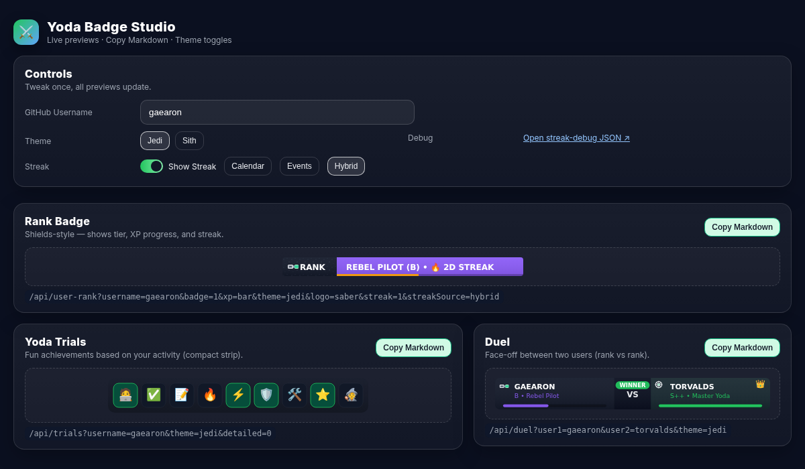

<div align="center">

# 🛡️ Yoda-Level GitHub Badge

**Turn your GitHub activity into a Star Wars–themed rank badge for your profile README.**
Tiers from *Force Beginner* to *Master Yoda*, sub-ranks, XP bars, streaks, achievements and head-to-head duels — all as plain SVG.

<a href="https://yoda-level-github-badge.vercel.app/ui"></a>
<br/>
<a href="https://yoda-level-github-badge.vercel.app/ui"></a>
<br/>
<a href="https://yoda-level-github-badge.vercel.app/ui"></a>

### [✨ Try it live — open the Badge Studio »](https://yoda-level-github-badge.vercel.app/ui)

[](LICENSE)
[](https://nextjs.org)

<a href="https://yoda-level-github-badge.vercel.app/ui"></a>

</div>

## ⚡ Add it to your profile in 30 seconds

1. Copy this line, replacing `YOUR_USERNAME` with your GitHub username:

   ```md
   [](https://yoda-level-github-badge.vercel.app/ui)
   ```

2. Paste it into the `README.md` of your profile repository (the repo named exactly like your username).
3. Commit — done. The badge refreshes automatically (cached ~20 minutes).

Prefer clicking? The **[Badge Studio](https://yoda-level-github-badge.vercel.app/ui)** previews every badge for any username and gives you a **Copy Markdown** button.

---

## ✨ Features

- **Auto-computed rank (0–100)** from GitHub activity (GraphQL preferred; REST fallback)
- **Granular sub-ranks** inside each tier: I → II → III → IV
- **XP indicator**: dots or bar, color-ramped by progress
- **Themes**: `jedi` (space-blue) or `sith` (crimson/black)
- **Streaks** (consecutive days with ≥1 contribution), computed from your contribution calendar, with an events-based fallback
- **Trials**: fun achievement badges based on your recent activity
- **Rank Duels**: shareable SVG posters for A vs B
- **Zero front-end required**: every endpoint returns SVG (or JSON if you want raw data)

---

## 🎨 More examples

**Sith theme + XP bar:**

```md
[](https://yoda-level-github-badge.vercel.app/api/user-rank?username=YOUR_USERNAME)
```

**Rank Duel — you vs a friend:**


```md
[](https://yoda-level-github-badge.vercel.app/api/duel?user1=YOUR_USERNAME&user2=THEIR_USERNAME&theme=jedi)
```

**Trials (achievements strip):**


```md

```

**Manual points badge (no GitHub calls):**

```md

```

> Running your own copy? Replace the domain with your deployment's — see [Self-hosting](#-self-hosting).

---

## 🔌 Endpoints

### 1) `/api/user-rank` — Compute rank from GitHub

* **Method**: `GET`
* **Returns**: `SVG` when `badge=1`, otherwise `JSON`

**Core params**

| Param          | Type   | Default   | Description                                                       |
| -------------- | ------ | --------- | ------------------------------------------------------------------ |
| `username`     | string | —         | GitHub username (required)                                        |
| `badge`        | 0\|1   | `0`       | `1` → return SVG badge; `0` → JSON                                 |
| `label`        | string | `Rank`    | Left-side label                                                   |
| `logo`         | enum   | `saber`   | `galaxy` \| `saber` \| `github`                                    |
| `theme`        | enum   | `jedi`    | `jedi` \| `sith`                                                   |
| `granular`     | 0\|1   | `0`       | Show sub-rank I–IV inside the tier                                 |
| `xp`           | enum   | `dots`    | `dots` \| `bar` \| `none`                                          |
| `showPoints`   | 0\|1   | `0`       | Append score (e.g., `82.5 pts`)                                    |
| `showNext`     | 0\|1   | `0`       | Append delta to next tier (e.g., `+2.0 to Grand Master`)           |
| `streak`       | 0\|1   | `0`       | Show streak on the badge text                                     |
| `streakMode`   | enum   | `classic` | `classic` (consecutive days ≥1) \| `momentum` (2-day rolling window) |
| `streakSource` | enum   | `calendar`| `calendar` \| `events` \| `hybrid` (merges both, taking the max). `calendar` needs a token and falls back to public events without one |
| `streakWindow` | number | `120`     | Days of history for streak calc (30–365)                           |
| `streakAnchor` | enum   | `lastActive` | `lastActive` (count back from your latest active day) \| `today`  |

**JSON example**

```
/api/user-rank?username=CosminBMemetea
```

```json
{
  "username": "CosminBMemetea",
  "points": 73.4,
  "rank": "B",
  "persona": "Rebel Pilot",
  "color": "#8b5cf6",
  "method": "graphql",
  "streak": { "mode": "classic", "days": 5, "source": "calendar" },
  "granular": { "band": "II", "nextTier": "Rebel Commander", "pointsToNext": 1.6, "pctWithinTier": 41.2 },
  "tiers": [
    { "grade": "S++", "name": "Master Yoda", "min": 98 },
    ...
  ]
}
```

**SVG example**

```
/api/user-rank?username=torvalds&badge=1&granular=1&xp=bar&theme=sith&streak=1&logo=saber
```

---

### 2) `/api/badge` — Static/custom badge (no GitHub calls)

* **Method**: `GET`
* **Returns**: `SVG`

**Params**

| Param        | Type   | Default       | Description                                                  |
| ------------ | ------ | ------------- | -------------------------------------------------------------|
| `label`      | string | `Rank`        | Left-side text                                                |
| `persona`    | string | `Master Yoda` | Right persona (ignored if `points` is provided)                |
| `grade`      | string | `S++`         | Right grade (ignored if `points` is provided)                  |
| `points`     | number | —             | If provided, maps points→tier and fills persona/grade/color    |
| `granular`   | 0\|1   | `0`           | Show I–IV inside tier                                          |
| `xp`         | enum   | `dots`        | `dots` \| `bar` \| `none`                                      |
| `showPoints` | 0\|1   | `0`           | Append numeric points                                          |
| `showNext`   | 0\|1   | `0`           | Add distance to next tier                                      |
| `logo`       | enum   | `saber`       | `galaxy` \| `saber` \| `github`                                 |
| `theme`      | enum   | `jedi`        | `jedi` \| `sith`                                                |
| `color`      | hex    | tier color    | Right-side color override, e.g. `ff8800` or `#f80`             |

**Example**

```
/api/badge?points=82.5&label=Rank&granular=1&xp=bar&showPoints=1&showNext=1&logo=galaxy
```

---

### 3) `/api/duel` — Head-to-head Rank Duel (shareable SVG poster)

* **Method**: `GET`
* **Returns**: `SVG` when `badge` isn't `0`, otherwise `JSON`

**Params**

| Param   | Type   | Default | Description                                             |
| ------- | ------ | ------- | -------------------------------------------------------- |
| `user1` | string | —       | First GitHub username (required; `u1` also works)        |
| `user2` | string | —       | Second GitHub username (required; `u2` also works)       |
| `theme` | enum   | `jedi`  | `jedi` \| `sith`                                          |
| `icon1` | enum   | `saber` | `github` \| `saber` \| `galaxy` \| `none` — left icon      |
| `icon2` | enum   | `galaxy`| `github` \| `saber` \| `galaxy` \| `none` — right icon     |
| `badge` | 0\|1   | `1`     | `0` → return JSON instead of SVG                          |

**Example**

```
/api/duel?user1=CosminBMemetea&user2=torvalds&theme=jedi
```

---

### 4) `/api/trials` — Achievement badges

* **Method**: `GET`
* **Returns**: `SVG` (icon strip or card grid), or `JSON` with `json=1`

**Params**

| Param          | Type   | Default      | Description                                              |
| -------------- | ------ | ------------ | ---------------------------------------------------------- |
| `username`     | string | —            | GitHub username (required)                                 |
| `theme`        | enum   | `jedi`       | `jedi` \| `sith`                                            |
| `detailed`     | 0\|1   | `0`          | `1` → multi-row card grid with descriptions; `0` → compact icon strip |
| `labels`       | 0\|1   | `0`          | Show short labels under icons in compact mode                |
| `cols`         | number | `3`          | Columns for the `detailed` card grid (1–4)                  |
| `title`        | string | `Yoda Trials`| Heading text                                                |
| `streakWindow` | number | `180`        | Days of history used for the streak-based trial (30–365)     |
| `json`         | 0\|1   | `0`          | `1` → return raw JSON instead of SVG                        |

Trials unlock based on recent activity: commits in the last 7/30 days, merged PRs, PR reviews, commit streaks, distinct issues opened, total stars, and reaching S-tier.

**Example**

```
/api/trials?username=CosminBMemetea&theme=jedi&detailed=1
```

---

### 5) `/api/streak-debug` — See what your streak is made of

Returns JSON with the per-day counts (UTC) and the streak computed with each anchor. Params: `username`, `daysBack` (30–365, default 180), `anchor` (`lastActive` \| `today`), `source` (`auto` \| `calendar` \| `events` \| `hybrid`).

```
https://yoda-level-github-badge.vercel.app/api/streak-debug?username=YOUR_USERNAME
```

### Errors

Invalid input never breaks your README: when you asked for an image (`badge=1`, `/api/duel`, `/api/trials`) you get a small red badge such as **GITHUB USER NOT FOUND** or **GITHUB API RATE LIMIT EXCEEDED**. JSON requests get the matching HTTP status (`400`, `404`, `429`, `502`) and `{"error": "…"}`.

Usernames must be valid GitHub logins; unknown values for enum params (`theme`, `logo`, `xp`, …) fall back to their defaults; free text (`label`, `title`) is capped in length.

---

## 🧮 Ranking System (0–100 → Persona)

* **S++**: Master Yoda (98–100)
* **S+**: Grand Master (≥96) • **S**: Jedi Master (≥94) • **S-**: Jedi Council (≥92) • **S--**: Sith Lord (≥90)
* **A+**: Obi-Wan Kenobi (≥85) • **A**: Jedi Knight (≥80)
* **B+**: Rebel Commander (≥75) • **B**: Rebel Pilot (≥70)
* **C+**: Padawan (≥65) • **C**: Youngling (≥60) • **C-**: Academy Cadet (≥55)
* **D+**: Frontier Scout (≥50) • **D**: Cantina Regular (≥45) • **D-**: Scrapyard Tech (≥40)
* **F+**: Moisture Farmer (≥30) • **F**: Force Beginner (≥0)

Sub-ranks inside each tier: **I** (entry) → **IV** (top).

---

## 🏠 Self-hosting

The public demo is free to use, but it shares one GitHub rate limit with everyone. For a busy profile, run your own copy — it takes a few minutes.

### Vercel (recommended)

1. **Fork** this repository.
2. Import the fork in [Vercel](https://vercel.com/new) — no build settings to change.
3. *(Optional, recommended)* add a `GITHUB_TOKEN` environment variable (see below) and redeploy.
4. Replace `https://yoda-level-github-badge.vercel.app` in your badge URLs with your deployment's domain.

### Docker

```bash
docker build -t yoda-badge .
docker run -p 3000:3000 -e GITHUB_TOKEN=your_token yoda-badge
# → http://localhost:3000/ui
```

The image runs as the unprivileged `node` user.

### Any Node.js host

```bash
npm ci
npm run build
GITHUB_TOKEN=your_token npm start   # listens on :3000
```

Requires Node.js 20.9+.

### 🔐 Environment variables

| Name           | Required    | Purpose |
| -------------- | :---------: | ------- |
| `GITHUB_TOKEN` | Recommended | Enables GraphQL (richer metrics, contribution-calendar streaks) and raises the rate limit to 5,000 req/hr. Without it the app uses public REST data (60 req/hr per server IP). |

Create a [fine-grained personal access token](https://github.com/settings/personal-access-tokens/new) with **no repository access and no permissions** — public profile data is all the app reads. Locally, copy `.env.example` to `.env.local` and fill it in. Never commit it.

**Per-request token (advanced):** API clients may send `Authorization: Bearer <token>` instead. Those responses are marked `private, no-store` so shared caches never serve them to anyone else. Don't put tokens in URLs.

### Caching

Badges are served with `s-maxage` (CDN cache, 10–60 min depending on the endpoint) plus `stale-while-revalidate`. GitHub's own image proxy also caches README images, so changes can take a little while to show up.

---

## 🛠 Troubleshooting

* **Badge says `GITHUB API RATE LIMIT EXCEEDED`** — the server hit GitHub's limit. Set `GITHUB_TOKEN` on your own deployment.
* **Badge says `GITHUB USER NOT FOUND`** — check the spelling of `username`.
* **Streak looks wrong** — open `/api/streak-debug?username=YOUR_USERNAME` to see the exact per-day counts (UTC). Without a token only public activity from the last ~90 days of events is visible.
* **README shows an old badge** — GitHub caches images; wait a few minutes or add a throwaway param like `&v=2`.

---

## 🧑‍💻 Development

```bash
npm ci
npm run dev         # http://localhost:3000 and /ui
npm run typecheck
npm test            # Vitest — GitHub is mocked, no token needed
npm run build
```

Built with Next.js (App Router route handlers) and TypeScript. Each endpoint lives in `app/api/<name>/route.ts`; shared logic is in `lib/`.

## 🤝 Contributing

Issues and pull requests are welcome! Read **[CONTRIBUTING.md](CONTRIBUTING.md)** for setup, project layout and guidelines, and use the issue templates for bugs and ideas.

## 🔒 Security

Please report vulnerabilities privately — see **[SECURITY.md](SECURITY.md)**.

## 📄 License

[MIT](LICENSE) — use it anywhere.

## 🙌 Credits

Star Wars–inspired styling for fun; not affiliated with Lucasfilm or Disney. GitHub data via the public REST and GraphQL APIs.
